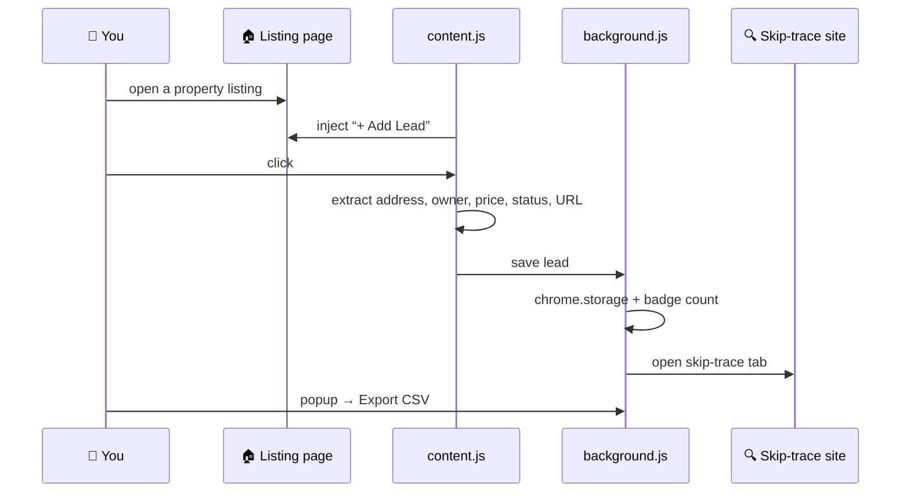
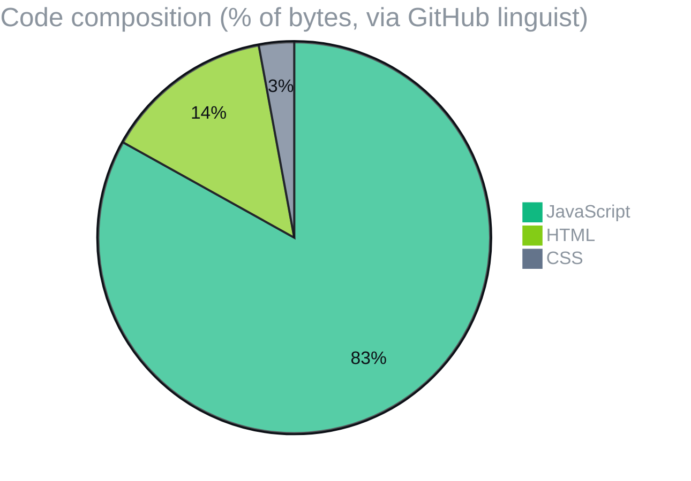

  

  
  
  
  

  
  
  
  

<h3 align="center">A floating “Add Lead” button on PropWire, Zillow, Homes.com and Trulia listings. One click captures the property and opens a skip trace.</h3>

  <a href="#-how-it-works">How it works</a> ·
  <a href="#-whats-in-the-box">What's in the box</a> ·
  <a href="#-field-manual">Field manual</a> ·
  <a href="#-license">License</a>

## 🧲 How it works

## 🧰 What's in the box

| File | Role |
|---|---|
| `manifest.json` | Manifest V3, host permissions for the four listing sites |
| `content.js` | Page parsing and the floating button |
| `background.js` | Storage, badge and tab handling |
| `popup.html` · `popup.js` · `styles.css` | Pending leads, CSV export, clear all |

> Use it within each website's terms of service and applicable privacy laws.

## 📊 Code composition

## 📚 Field manual

One-click lead capture from real estate websites. Auto-skip trace via CyberBackgroundCheck.

## Supported Sites
- ✅ PropWire
- ✅ Zillow
- ✅ Homes.com
- ✅ Trulia

## Features
- 🏠 Floating "Add Lead" button on property pages
- 🔍 Auto-extracts: address, owner, price, status, listing URL
- 📞 One-click skip trace via CyberBackgroundCheck (opens in new tab)
- 📊 Export all leads to CSV (import to Google Sheets)
- 🔢 Badge shows pending lead count
- 💾 Leads stored locally until you export

## Installation

1. Open Chrome → go to `chrome://extensions/`
2. Enable **Developer mode** (top right toggle)
3. Click **Load unpacked**
4. Select this folder (`lead-scraper-extension`)
5. Done! Visit any property page on PropWire/Zillow/Homes.com/Trulia

## How to Use

1. **Browse** to a property listing on any supported site
2. Click the **🏠 + Add Lead** button (bottom right corner)
3. A new tab opens with CyberBackgroundCheck skip trace
4. Enter the phone number you find there
5. Click the extension icon (puzzle piece) to:
   - View pending leads
   - Export to CSV
   - Clear all leads

## Export to Google Sheets

1. Click extension icon → **Export CSV**
2. Open your Google Sheet: https://docs.google.com/spreadsheets/d/1GjB4P5SKiMoZDrlkuOvgetpynYhE0yTPFm-R56NLZhg/edit
3. File → Import → Upload the CSV
4. Done!

## Coming Soon
- Direct Google Sheets push (no manual import)
- Auto phone number extraction from CyberBackgroundCheck
- Bulk lead import from search result pages
- Jarvis AI integration (auto-scripts, follow-up reminders)

## 📜 License

Released under the [MIT License](LICENSE). Use it, fork it, ship it.

  Built by <a href="https://github.com/F0rger123"><b>@F0rger123</b></a> · MIT licensed

